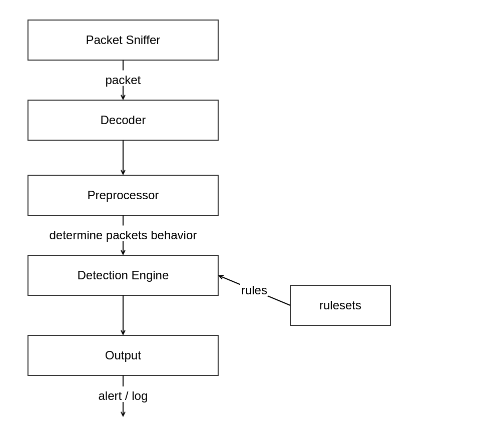

# Snort 相關使用說明

Snort 的運作原理：


## 1. 安裝

可以參考 [這篇](https://blog.rapid7.com/2017/01/11/how-to-install-snort-nids-on-ubuntu-linux/) 的教學，記得調整版本號到你需要的版本。

## 2. 使用

### 情境 - [**直接讀取 pcap**](http://manual-snort-org.s3-website-us-east-1.amazonaws.com/node8.html)
* 由於我們需要真實情境的流量，作為後續實驗當中 benign traffic 的角色。所以透過工具來對現有流量側錄後，以 pcap 型式在我們的實驗當中重播（via `tcpreplay`）。
* 所以 snort 作為我們的流量分析工具，作為對該 pcap 產生可信度高的 ground truth 依據。

執行:
```bash
snort -r <pcapfile>
```

便可以獲得 pcapfile 所對應的分析資訊（各種網路流量類型所佔的比例）。而從上方圖片可以看到，Snort 本質上是基於 rule-based 的 IDS，所以當我們沒有將任何的 rulesets 放到 snort-dependent 的資料夾底下時，便會直接通過 detection engine，直接輸出，如下方格式：
```
...
=+=+=+=+=+=+=+=+=+=+=+=+=+=+=+=+=+=+=+=+=+=+=+=+=+=+=+=+=+=+=+=+=+=+=+=+=+
WARNING: No preprocessors configured for policy 0.
12/14-15:49:04.077388 140.116.245.243:58879 -> 255.255.255.255:17000
UDP TTL:64 TOS:0x0 ID:60109 IpLen:20 DgmLen:39 DF
Len: 11
=+=+=+=+=+=+=+=+=+=+=+=+=+=+=+=+=+=+=+=+=+=+=+=+=+=+=+=+=+=+=+=+=+=+=+=+=+

...

===============================================================================
Run time for packet processing was 133.165274 seconds
Snort processed 1941058 packets.
Snort ran for 0 days 0 hours 2 minutes 13 seconds
   Pkts/min:       970529
   Pkts/sec:        14594
===============================================================================
Memory usage summary:
  Total non-mmapped bytes (arena):       782336
  Bytes in mapped regions (hblkhd):      21590016
  Total allocated space (uordblks):      677568
  Total free space (fordblks):           104768
  Topmost releasable block (keepcost):   101744
===============================================================================
Packet I/O Totals:
   Received:      1941058
   Analyzed:      1941058 (100.000%)
    Dropped:            0 (  0.000%)
   Filtered:            0 (  0.000%)
Outstanding:            0 (  0.000%)
   Injected:            0
===============================================================================
Breakdown by protocol (includes rebuilt packets):
        Eth:      1941058 (100.000%)
       VLAN:            0 (  0.000%)
        IP4:      1749917 ( 90.153%)
       Frag:            0 (  0.000%)
       ICMP:        21054 (  1.085%)
        UDP:       440726 ( 22.705%)
        TCP:      1285205 ( 66.212%)
        IP6:        56196 (  2.895%)
...
Snort exiting
```

所以我們可以將既有的 ruleset (可以從 [snort 官方網站上找到相關 public rules](https://www.snort.org/downloads/#rule-downloads) 來做下載)

> TODO:
> * [ ] 加入 ruleset 的方法、以及如何寫 snort rule 


## Useful Reference/Resource

* [How to use Snort](http://usuaris.tinet.cat/sag/lsnort.htm)