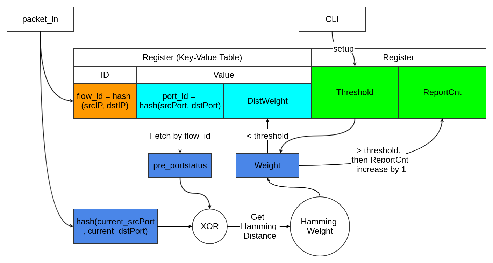

# Distance-based Portscan

與 volume-based 類似的作法，但這次不單是與上一個儲存的 port id 比較異同，而是與前次的 port id 之間取 Hamming Distance 後，將這 Hamming Distance 取其 Hamming Weight 後，做累加。當其累加值超過所設定的 threshold 後，便將 Report Counter 累加一次。

透過 tcpreplay 的方式，我們將一份於我自己實驗室電腦（IP: `140.116.245.247`）所錄製的流量 - 1.1G，整份 available packets 數量為 `1678982` 個，當中 unique hosts 數量為 `10432` 個，以 `100 mbps` 的速度於 software switch 與 mininet 的摹擬網路當中做測試。（以上數值由 tcpreplay 所示，以及透過 eva/ 底下的相關分析程式所統計）

在發生 hash collision 的考量下，以下是 Report 次數與 Table size 的圖表：

| Table size | Hash Algorithm | Weight Threshold | Report Count |
| :--- | :--- | :--- | :--- |
| 512 | crc16 | 30 | 32429 (1.93%) |
| 512 | crc16 | 80 | 11802 (0.70%) | 
| 512 | crc16 | 2131 | 465 (0.02%) |
| 512 | xxhash | 30 | 24226 (1.44%)  | 
| 512 | xxhash | 60 | 12973 (0.77%) |
| 1024 | xxhash | 60 | 12683 (0.75%) |

* 可以看到，適當使用 collision 較低的 hash function 能有效改善回報的次數。
* 提高 threshold 能大幅降低回報次數（只回報改動劇烈的）
* 而在提高 threshold 後，提高 Table size 回報次數並沒有顯著的下降。

## 思考

在確認差異前，是否考量加入 timeout 的機制？ 概念上是由於一定時間後，該 flow id 上所進行的行為是否換成下一個服務？ 那麼 Weight 的累計值照理說就要進行清空的動作。（這個在增加 weight threshold 也能變相達到相同目的）