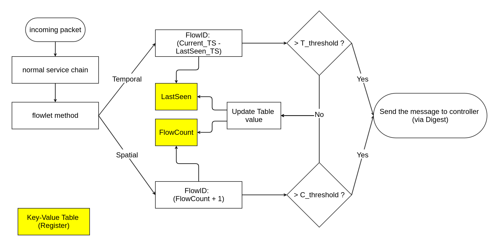

# Flowlet

這部份主要探討 flowlet 項特性，並以 P4 來實作這個性質，並用簡單的實驗來做測試。

## Workflow

我們提出使用 flowlet 的情境如上圖所示，在封包進來時，在通過一般的 network function 後，進入到我們的以 flowlet 做資料收集的 control block；而這時我們可以選擇使用 temporal 或是 spatial 的 flowlet。
* `Temporal` 的版本：將所有 Flow 的資訊儲存在 LastSeen 的 register table 當中，並且以 packet 進入 switch 的 timestamp 為主，將目前 packet 的 timestamp 減去上一次看到同樣 flow id 的 timestamp，並與所設定的 threshold 來做比較。當差值大於該 threshold 時，我們則可以將該 packet 做回報（給 controller/collector 做後續處理），並抽取所需要的欄位做處理。
* `Spatial` 的版本： 將所有 Flow 的資訊儲存在 FlowCount 的 register table 當中，並以該 flow 出現的次數來做儲存。判斷當 flow 的數量超過我們所設定的 threshold 時，我們便可以將該 packet 來做回傳。

在我們的實作當中，是選用 Digest 來實作回報的功能。

## Program execution

使用 tmux 開啟視窗後，將視窗切分為左右兩側。

* 一側運行 `./build.sh` 來執行整個網路拓樸、以及運行對應的 p4 switch 及部署我們開發的 P4 program
* 另一側則運行 `./start_p4_controller.sh temporal` 或是 `./start_p4_controller.sh spatial` 來運行不同的 flowlet scenario。
* 而原本運行 `./build.sh` 在完成工作後，便會進入到 mininet CLI 當中。這時我們呼叫 `xterm h1` 來開啟 h1 的 xterm terminal，並呼叫 `./sender.sh` 來執行 TCP 封包的傳輸工作。這時可以看到另一側 controller 的視窗會出現 digest 回送的內容。將傳送所示的內容與 digest 的格式、以及所運行的 sender.sh 的欄位一一做比對，便可以看到，這個 **以 flowlet 為單位做回報的實驗** 所獲得的結果。