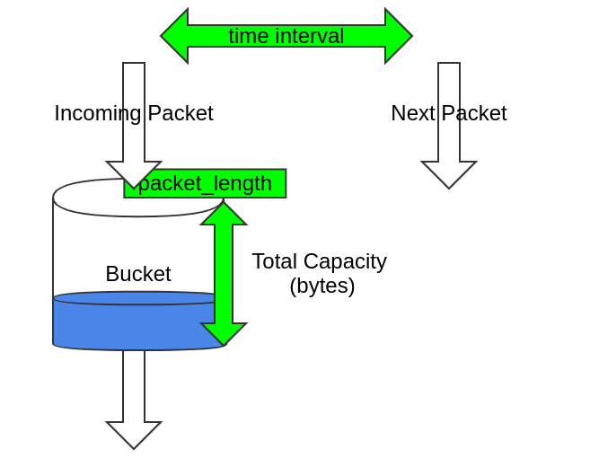
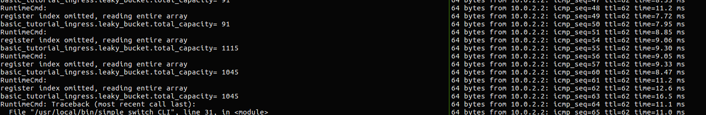

# Leaky bucket 

Leaky bucket 示意圖：


類似於 token bucket 的作法，在 sw 上維持一個桶，內含預設的容量大小。當一個 packet 進來時，便會對該容量作減少，如同桶漏水的情況。當水漏完後，在沒有補充機制下，便沒辦法在漏出水，等同於封包便沒有辦法再度通過。

暫時的想法是透過 packet 之間 inter-arrival time 的大小來做設定，比方說在超過一定時間內沒有封包進入後，便會 `挹注新的水進入桶中`、或是直接 reset。

運行結果：

左側透過 simple_switch_CLI 來檢視目前 total capacity 的數量（available byte count），可以看到在右側運行 ping command 於 mininet CLI （h1 ping h2），造成 total capacity 的數量減少；然而在一定時間的阻斷後，當超過一段時間 (inter-arrival time threshold) 後，便能夠重新挹注 capacity 的流量空間進入到桶中，使得兩邊之間的封包能夠繼續傳遞，並且能控制其一定時間內所能經過的流量。

Pseudo Code:
```
// Capacity (leakying)
if Packet_in is available:
    capacity -= Packet_in.packet_length
    if capacity < 0:
        drop();
    else:
        Update capacity value (write back into stateful memory)

// Inter-arrival time (filling)
delta_ts = current_ts - lastseen_ts // ts = timestamp
if delta_ts > threshold_ts :
    capacity += FILL_CAP // capacity of each fill 
    if delta_ts > n*threshold_ts: // if waiting for a long time

// Failure check (TODO)
if failture_time > threshold:
    capacity = FULL_CAP >> 1; // Set the maximum to half of origin
    send_to_cpu(); // send this packet header info to controller
```