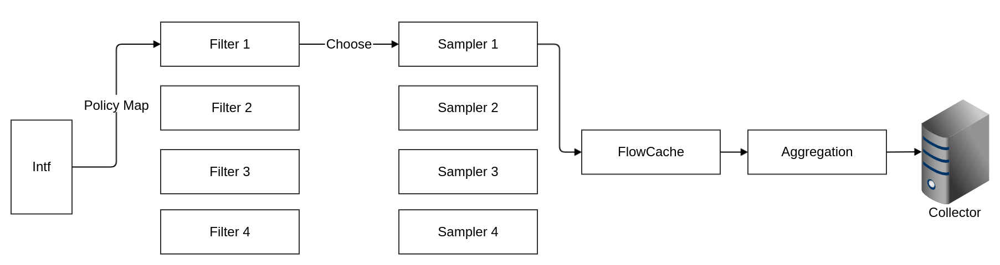
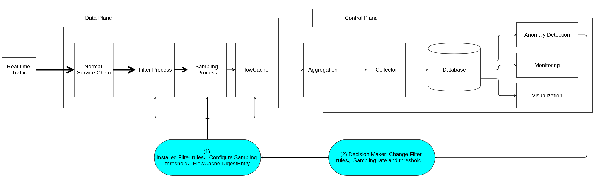
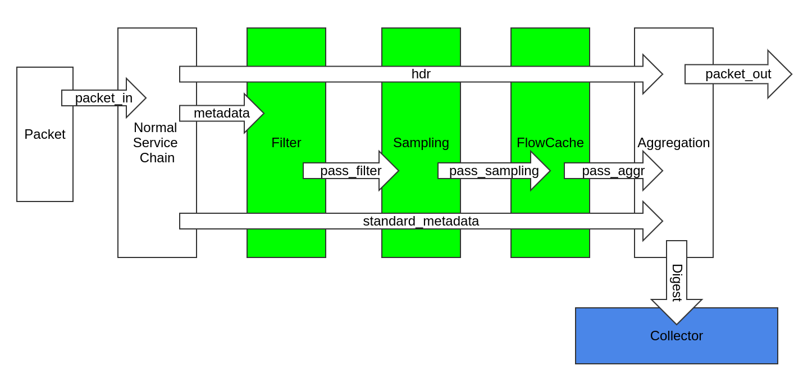
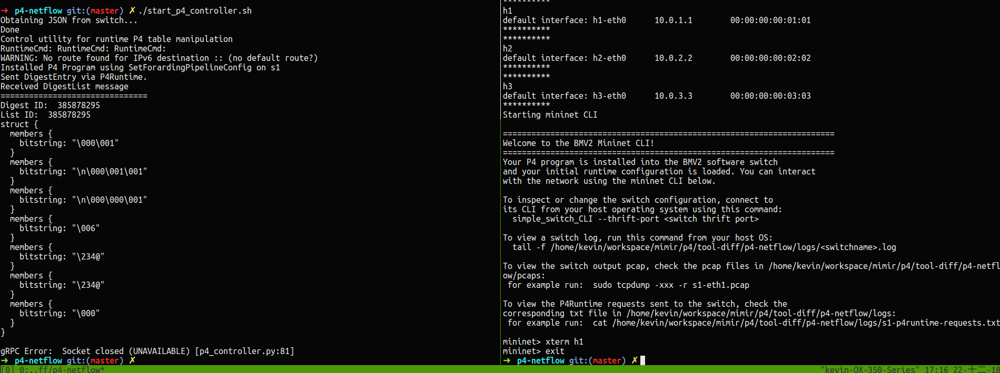

# P4-NetFlow

使用 P4 來實作類 NetFlow 功能的場景。

## How does NetFlow work? 

可以看到，在封包經過 interface 時，可以依據 Policy map 將 traffic 打進哪一個 sampler 當中。這麼一來，我們 **可以依據不同 traffic、來選擇我們需要的 sampling rate**。（*這麼一來，便能夠達成在 `overhead` 與 `accuracy` 之間取得平衡*）

再來經過 Sampler，我們便能夠依據所設定的 sample rate 來對 traffic 做採樣，並將選擇採樣的 packet header 送到 FlowCache 當中儲存。

而 FlowCache 的機制，將儲存起來的資訊，在 "適當的時機" 回傳給 Collector。這個適當的時機，則是由 router 所設定的 Active/Inactive timeout value 所決定，當這個時間到了，就會將 FlowCache 的內容送到 Collector 去。

在 FlowCache 送到 Collector 之間，還有個 Aggregation 的模組。負責將 individual flow 做合併、也就是不以獨立的 flow、而是以 **network prefix 作為單位**，將資訊依據所選的 prefix 做整合後再回傳。（**依據計算的複雜度，這個組件應該也可以被當作 control plane 的一個部份，或是透過 P4 上的 register table 做初步的資訊整合，回傳的資訊就以 table 內 entry 的 value 為主。**）

Collector 就是資料收集的單位，這部份定位為 Controller。

> 可以從上述的介紹當中看出，NetFlow 是一個在傳統網路架構中便使用 push-based 機制的資料收集方式。

## How to use P4 to implement this structure?

### Filter

主要功能為 - **"決定觀察的範圍，並指定 traffic 導到哪一個 Sampler 做後續處理"**。

這部份的實作可以利用 P4 提供的 Match/Action Table 的功能，將 key 設定為 **ternary matching**，並且依據 mask 來選擇觀察的範圍。再來是 action 的部份，我們可以將所選擇的結果，儲存在 metadata 當中（e.g. `sampling ID`），並在 filtering stage 結束後，由 sampling stage 察看 metadata 中的這項欄位，決定匹配的 Sampler。

### Sampler

而在 Sampler 的主要功能為 - **"只處理部份的 packet，並將這些經由 sampling rate 所採樣到的 packet header 送到 FlowCache 做處理/保存。"**

這個部份，我們可以利用 Temporal 或是 Spatial 的 Sampling - 
* Temporal: 採樣取決於一定的時間間隔，e.g. 在每 5 s 時對 traffic 做一次採樣。
* Spatial: 採樣取決於該 flow 的 counter 大於某個閥值（e.g. 能透過 controller 設定這個閥值）時，將該資料打包後，送到 FlowCache 當中做儲存，等待時機到時，再向 Collector 回傳這些資料。

### FlowCache

主要功能為 - **"儲存要回傳的資訊，並在達到 `所設定的時間點/時間長度` 後，將收集的資訊送給 Collector。"**

從這個描述當中，可以清楚的看到，其行為與 P4 當中的一項功能 - **Digest Message 的機制非常的類似**。我們可以從支援 P4 的 Controller 上對 target device 設定 DigestEntry，將 `max_timeout_ns`、`max_list_size`、`ack_timeout_ns` 這幾項欄位設定好之後，便能夠在我們所設定的時機將 Digest Message List 回傳。

### Aggregation

主要功能 - **"將多個 individual flow（e.g. 獨立 IP 為單為）合併成以 Network prefix 為單位的資訊。"**

這個模組位於 FlowCache 與 Collector 之間，在 P4 上雖然有提供計算能力，但對於 IP aggregation 的計算仍然是大於合理的計算範圍。所以有兩種實作方向：
* `On Data Plane` : 在 FlowCache 的儲存機制上，將 aggregation 的功能給做進去。在 FlowCache 的儲存過程，原本是直接呼叫 Digest 的 pack() method 來將 Digest message 儲存進 switch agent 上的 Digest Queue 當中（等待時機成熟、便將透過 DigestList 的 grpc 通道將這 Digest Queue 所有 Digest Message 上傳）。而我們便在 Sampler 採樣到的資料、與 FlowCache 呼叫 Digest method 之間，再加入一個由 `Register` 所建立的 Key-Value Table，來做儲存 Aggregation 資訊。透過指定的 Hashing 方式（選擇哪幾個 key 來做 hashing），並將擁有相同的 flow id 的 packet 的資料做累加（比如用 counter 作為 KV table 當中的 value、或是以多個 table 來保存該 flow id 所持有/保存 **多筆資料**。）
* `On Control Plane`：將 aggregation 製作在 Local controller 當中，讓 Local controller 來做這件事。並在做完 aggregation 後，再將整合過後的資訊，送到 Collector 或是 Remote controller 上。

### Collector 

主要功能 - **"將資料做分析、或是視覺化展示。或是提供手動/自動化控制，依據所收集的資料，對所監控觀察的網路做管理。"**

而在提供控制這部份上，若是加上 `Anomaly Detection Algorithm`，就可以構成一個 IDS（Intrusion Detection System） 的雛型（擁有資料收集、資料分析處理、以及對應控制處理的功能）。 

以 P4 架構來看這部份的實作，主要會以 Python 的 Controller 來實作這部份的功能。讓操作、與資料接收都一併由 Python 的 P4Runtime Controller 來做統一處理。

## P4-NetFlow Mechanism

* Workflow

* Dataflow

## P4-NetFlow Implementation 

在介紹完機制以及設計後，我們便可以進到實作層面。從上面的圖解當中，可以看到我們的流量會經過：
* Filter: 攔截我們想觀察的單位（*在實驗當中，為了減少複雜度，我們選擇將 filter 的部份暫時停止功能，將所有的 flow 都通過 filter*）
* Sampling: 為了緩解 control plane 與 data plane 之間通訊的頻率，達到 **mitigation** 的效果、限制觀察 flow 的回報頻率。這邊實作上採用了 register table 以及 threshold 來達到這項功能。
  * 我們將通過 filter 的流量，依據其 flow id (實作上，我們選用 5-tuple 搭配 crc16 的 Hash algorithm) 作為 key，對應的 value 為最近一次看到這條 flow 的時間（實作上我們選用 BMv2 standard_metadata 內的 `ingress_global_timestamp` 這個欄位）
  * 在新的擁有相同 flow id 的 packet 進來時，先從這個 table 當中取出該 flow id 對應到的 value (e.g. 也就是最近一次看到該 flow 的時間)，並用目前 packet 的 standard_metadata 當中的 ingress_global_timestamp 來做相減，取 delta time，並且跟設定好的 Delta_Time_Threshold 做比較。 當 delta time 超過所設定的閥值時，便將該 packet 的 metadata.pass_sampling 設為 1，表示將該 packet 資訊送到 flowcache 當中做儲存。
* FlowCache & Aggregation: 而在這個部份，由於考量到 NetFlow 擁有 Aggregation 的功能，所以我們將 Aggregation 的特性一樣利用 register 所製成的 K-V table 來完成，利用對送到 flowCache 的 traffic 依據 flow id （以 NetFlow 的設定，是選擇 *七項欄位* 做為 flow id 的判斷。）做 counting，並當 counter 數值大於所設定的 threshold 時，將 metadata.pass_aggr 的旗標拉起來，讓在下個 stage 中判斷 pass_aggr 來 **決定是否呼叫 Digest，將要保存的資訊存進設定好的 Digest data structure 中。**

這麼一來，在運行起我們的系統後，在 mininet CLI 當中開啟連接 s1 的 h1，並且使用寫好的 sender 指令 `./sender.sh` 呼叫 python 腳本來傳送大量封包，作為觸發我們所設定的條件，並在另一個已經開啟 `./start_p4_controller.sh` 當中，看到 target switch 回傳上來的訊息（這訊息類似於 NetFlow 的機制當中 sw 上傳給 Collector 的訊息），可以看截圖結果左側部份收到的訊息：

> 由於當時實作時，simple_switch_grpc 並沒有實作 register write/read 的功能，所以我是透過 simple_switch_CLI 來將各個 stage 的 threshold 做設定。 
> 
> 並利用 DigestEntry 來設定 FlowCache 將收集的資訊回傳給 Collector 的頻率、時機。

